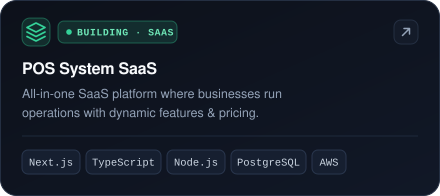
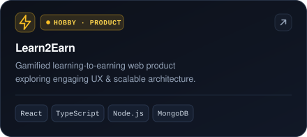
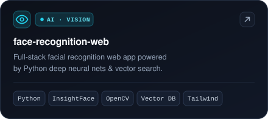
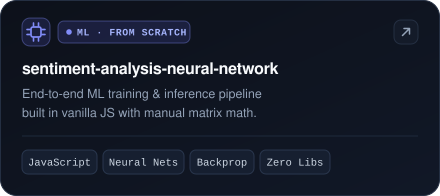
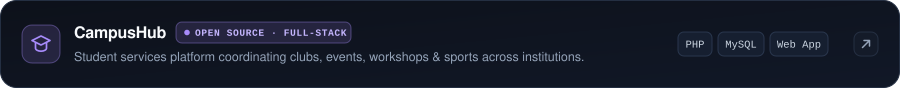
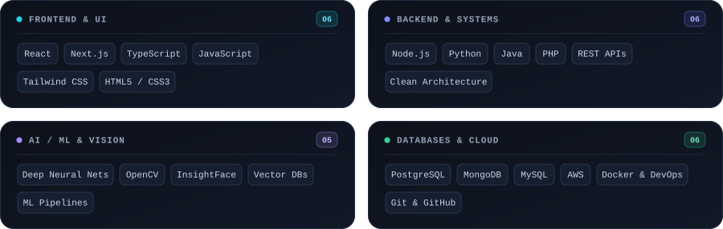

  <picture>
    <source media="(prefers-color-scheme: dark)" srcset="./assets/hero-dark.svg" />
    <source media="(prefers-color-scheme: light)" srcset="./assets/hero-light.svg" />
    
  </picture>

  <picture>
    <source media="(prefers-color-scheme: dark)" srcset="./assets/about-dark.svg" />
    <source media="(prefers-color-scheme: light)" srcset="./assets/about-light.svg" />
    
  </picture>

### Featured Projects

  <a href="https://github.com/banujakaushalya" target="_blank">
    <picture>
      <source media="(prefers-color-scheme: dark)" srcset="./assets/project-pos-dark.svg" />
      <source media="(prefers-color-scheme: light)" srcset="./assets/project-pos-light.svg" />
      
    </picture>
  </a>
  &nbsp;
  <a href="https://github.com/banujakaushalya" target="_blank">
    <picture>
      <source media="(prefers-color-scheme: dark)" srcset="./assets/project-learn2earn-dark.svg" />
      <source media="(prefers-color-scheme: light)" srcset="./assets/project-learn2earn-light.svg" />
      
    </picture>
  </a>

  <a href="https://github.com/banujakaushalya/face-recognition-web" target="_blank">
    <picture>
      <source media="(prefers-color-scheme: dark)" srcset="./assets/project-face-dark.svg" />
      <source media="(prefers-color-scheme: light)" srcset="./assets/project-face-light.svg" />
      
    </picture>
  </a>
  &nbsp;
  <a href="https://github.com/banujakaushalya/sentiment-analysis-neural-network" target="_blank">
    <picture>
      <source media="(prefers-color-scheme: dark)" srcset="./assets/project-sentiment-dark.svg" />
      <source media="(prefers-color-scheme: light)" srcset="./assets/project-sentiment-light.svg" />
      
    </picture>
  </a>

  <a href="https://github.com/banujakaushalya/campushub" target="_blank">
    <picture>
      <source media="(prefers-color-scheme: dark)" srcset="./assets/project-campushub-dark.svg" />
      <source media="(prefers-color-scheme: light)" srcset="./assets/project-campushub-light.svg" />
      
    </picture>
  </a>

### Tech Stack

  <picture>
    <source media="(prefers-color-scheme: dark)" srcset="./assets/tech-stack-dark.svg" />
    <source media="(prefers-color-scheme: light)" srcset="./assets/tech-stack-light.svg" />
    
  </picture>

### GitHub Analytics & Activity

  <picture>
    <source media="(prefers-color-scheme: dark)" srcset="./assets/stats-dark.svg" />
    <source media="(prefers-color-scheme: light)" srcset="./assets/stats-light.svg" />
    
  </picture>

  <picture>
    <source media="(prefers-color-scheme: dark)" srcset="./assets/snake-dark.svg" />
    <source media="(prefers-color-scheme: light)" srcset="./assets/snake-light.svg" />
    
  </picture>

### Let's Connect

<!-- TODO: Update YOUR_LINKEDIN, YOUR_PORTFOLIO_URL, and YOUR_EMAIL@example.com -->

  <a href="https://linkedin.com/in/YOUR_LINKEDIN" target="_blank">
    <picture>
      <source media="(prefers-color-scheme: dark)" srcset="./assets/social-linkedin-dark.svg" />
      <source media="(prefers-color-scheme: light)" srcset="./assets/social-linkedin-light.svg" />
      
    </picture>
  </a>
  &nbsp;
  <a href="https://YOUR_PORTFOLIO_URL" target="_blank">
    <picture>
      <source media="(prefers-color-scheme: dark)" srcset="./assets/social-portfolio-dark.svg" />
      <source media="(prefers-color-scheme: light)" srcset="./assets/social-portfolio-light.svg" />
      
    </picture>
  </a>
  &nbsp;
  <a href="mailto:YOUR_EMAIL@example.com">
    <picture>
      <source media="(prefers-color-scheme: dark)" srcset="./assets/social-email-dark.svg" />
      <source media="(prefers-color-scheme: light)" srcset="./assets/social-email-light.svg" />
      
    </picture>
  </a>
  &nbsp;
  <a href="https://github.com/banujakaushalya" target="_blank">
    <picture>
      <source media="(prefers-color-scheme: dark)" srcset="./assets/social-github-dark.svg" />
      <source media="(prefers-color-scheme: light)" srcset="./assets/social-github-light.svg" />
      
    </picture>
  </a>

  

  <picture>
    <source media="(prefers-color-scheme: dark)" srcset="./assets/footer-dark.svg" />
    <source media="(prefers-color-scheme: light)" srcset="./assets/footer-light.svg" />
    
  </picture>

